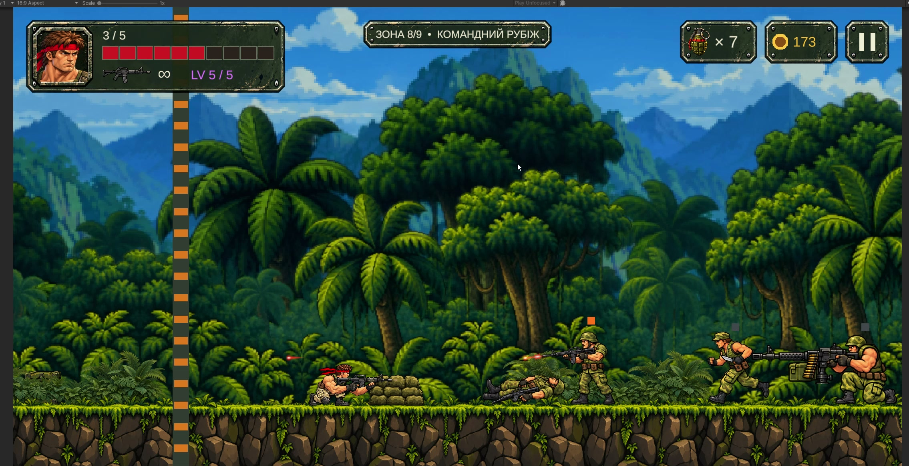
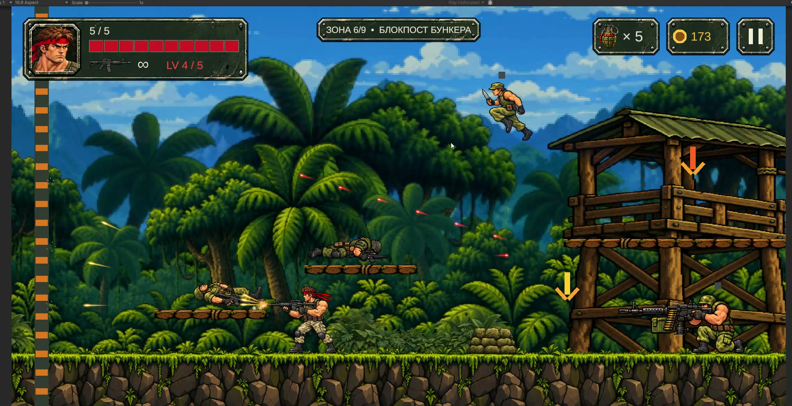

# RED ZONE

**Personal Unity / C# project | 2D run-and-gun | Public Windows prototype**

[Download the free prototype](https://vitaliy-gamedev.itch.io/red-zone) · [Game design portfolio and GDD downloads](https://vitaliy-gamedev.itch.io/red-zone#download)

## Playable scope

- One Jungle mission with nine combat sectors, waves, checkpoints and bush ambushes.
- Rifle soldiers, runners, snipers, machine gunners, grenadiers and a multi-phase boss.
- Movement, crouching, double jump, aim assist, shooting, knife attacks, grenades and five weapon levels.
- Main menu, pause menu, boss encounter, extraction and mission results.

This is an early prototype, not a completed campaign. Android and additional levels are future work. Informal playtesting involves five acquaintances; consolidated feedback and completion metrics have not yet been recorded.

## My contribution

Concept, design requirements, priorities, part of the C# implementation, component integration, scene configuration and manual playtesting. I iterate on combat pacing, spawn boundaries, collisions, targeting, controls and presentation.

## Technical architecture

| Responsibility | Components / approach |
| --- | --- |
| Input and movement | `PlayerInputReader` uses Input System; `PlayerMovement` handles movement and stance |
| Player combat | Separate shooting, melee and grenade components; interval-based target scanning and cover checks |
| Projectiles | `ProjectilePool` preallocates a bounded capacity, simulates active shots centrally and uses O(1) swap-removal; `GrenadePool` reuses grenades |
| Collision and damage | Physics2D CircleCast checks; `Health.Damaged` / `Died` events |
| Encounters | `WaveArena` states handle warnings, waves, gates and completion; route activation and enemy pooling |
| Boss | `HunterBossController` states handle repositioning, jumping, wind-up, bursts and recovery |
| Presentation | ScriptableObject animation libraries, sprite views, Cinemachine, parallax and pooled combat feedback |
| Mission flow | Dedicated session, checkpoint, extraction and results components |

Environment: Unity **6000.3.6f1**, URP **17.3.0**, Input System **1.18.0**, Cinemachine **3.1.7**.

**The full RED ZONE source and assets are not included in this repository.** The public download is a playable Windows build, not an editable Unity project.

## Controls

| Action | Input |
| --- | --- |
| Move | A / D or arrow keys |
| Jump / double jump | Space |
| Crouch | S / Ctrl / Down |
| Fire with aim assist | Left mouse button |
| Knife | Right mouse button |
| Grenade | G |
| Pause | Esc |

Extract the complete ZIP before launching `REDZone.exe`; keep its Data folder and DLL files beside it.

## Design evidence

The itch.io downloads include an illustrated portfolio and original Ukrainian GDDs. Historical specifications and future concepts are labelled; they do not all describe the current playable build.

Both images are real Game View captures from the prototype recording dated 16 October 2026, not concept art.

## Opportunities

Open to remote Junior / Trainee Unity Developer roles, collaboration and publishing discussions. Acquisition or licensing can be discussed subject to agreement and applicable asset rights; no automatic rights to third-party resources are offered.

[Contact](mailto:vitaliy.gamedev.ua@gmail.com) · [Back to portfolio](../../README.md)
